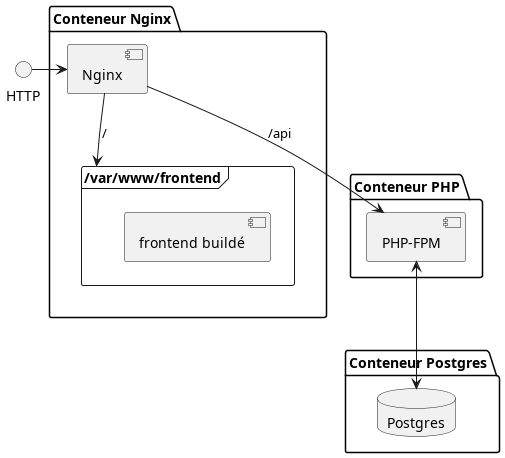
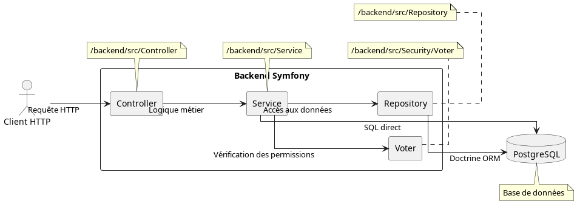
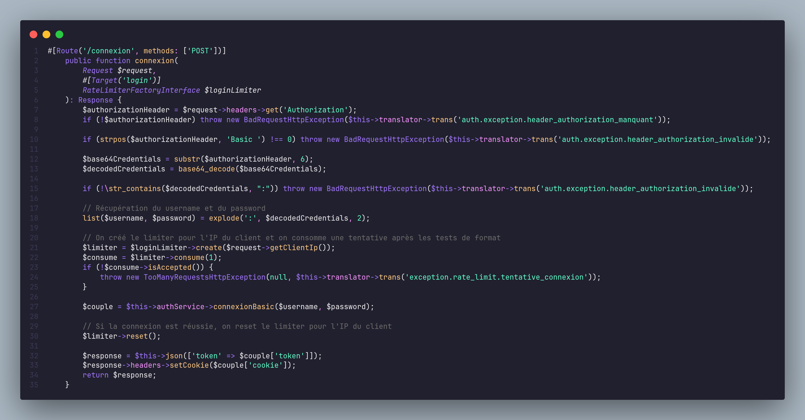

# Architecture de l'application

L'image du nginx contient dans ses dossiers le /dist du build de frontend React et y dirige les requêtes /. En cas de /api c'est un reverse proxy allant sur le conteneur php faisant tourner un php-fpm. C'est les seules choses accesibles depuis l'extérieur. La base elle étant accsible que par le conteneur php.

## Architecture de Symfony

En cas de problème dans l'application, pour la débuguer la solution la plus simple c'est de suivre le problème. Afficher l'appel problématique du frontend avec sa méthode par example /api/connexion en POST. Rechercher dans le dossier Controller un fichier avec comme route /connexion (le /api correspond au dossier Controller donc seulement ce qui suit le /api) et comme methods POST.

Ici on le retrouve dans le AuthController.php

À partir d'ici nous avons l'entrée de la requête dans symfony et on peut désormais dérouler les fonctions pour remonter au problème.

