# Dictionnaire

Dans SOCLE le dictionnaire des données est géré en base de données.
En cas d'ajout de modification ou de suppression il faut donc modifier des records de base.

> [!CAUTION]
> Pour supprimer un élément du dictionnaire il faudra d'abord supprimer ou modifier tous les endroits où l'id de l'élément est référencé. L'effet cascade peut être extrêmement large.

## Modifier les laboratoires/employeurs/institutions/source de financement

Les laboratoires, les employeurs, les institutions et les sources de financement sont toutes la table entité. Pour définir le record comme une source de financement il faut l'affilier à une categorie de la table categorie.

### Catégorie source de financement
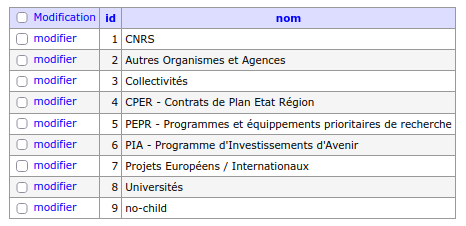

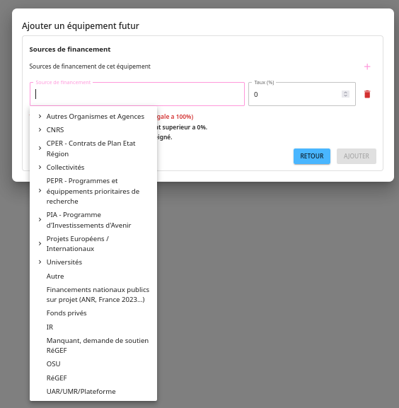

Ainsi en donnant un `categorie_id` à un record, on l'ajoute dans les sources de financement et dans la bonne catégorie.

> [!NOTE]
> La catégorie 9 'no-child' permet au record d'être référencé à la racine des sous de financement donc sans catégorie.

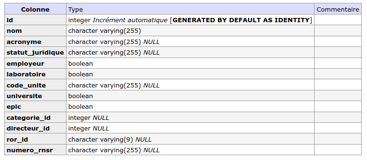

Les booléans vont servir à identifier ce que sera le record.
- `employeur` = true|false. Est-ce que le record est un employeur ? Si c'est un employeur on voudra également remplir le booléan `universite` pour savoir si le record est une université (utilisé pour les universités de rattachement des doctorants) et le boolean `epic` pour savoir l'étblissement est un epic. Si ça peut également être une source financement on devra renseigner une catégorie dans `categorie_id`. On voudra également avoir le `ror_id` de renseigné.

- `laboratoire` = true|false. Est-ce que le record est un laboratoire ? Si c'est un laboratoire on voudra également remplir le `code_unite` et le `numero_rnsr`.

- `universite` = true|false. Est-ce que le record est une université ?

- `epic` = true|false. Est-ce que le record est un epic.

#### Exemple

CNRS (insitution) :

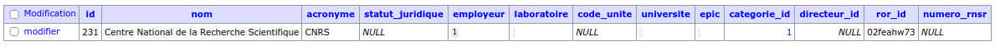

Université de Lorraine (université) :

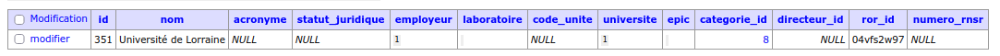

OTELo (laboratoire) :

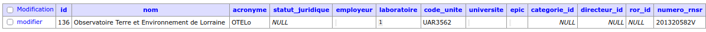

ADEME (epic) :

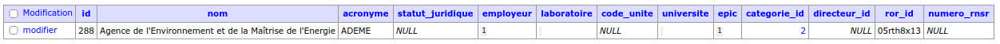

## Modifier les baps et emplois types

Les records BAP (`bap`) et les records Emplois Types (`emploi_type`) sont reliés par la table pivot `bap_emploi_type`. Ainsi pour ajouter une bap ou un emploi type il suffit simplement d'ajouter un record dans la table concernée puis de lier cette bap ou cet emploi type à l'autre via leurs id dans la table bap_emploi_type.

Bap :

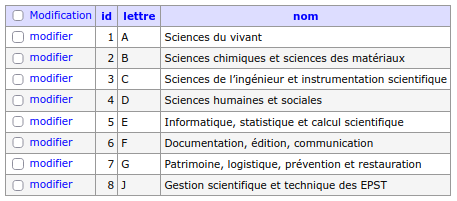

Emploi Type :

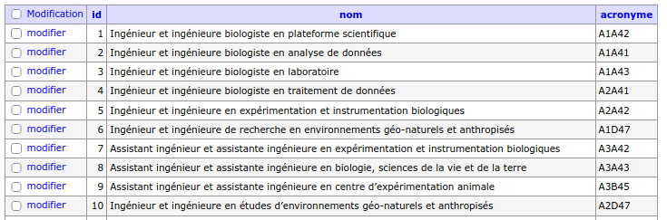

bap_emploi_type :

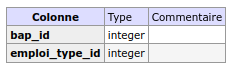

## Modifier les corps et grades

Les records `corps` et les records `grade` sont reliés par la table pivot `corps_grade`. Ainsi pour ajouter un corps ou un grade il suffit simplement d'ajouter un record dans la table concernée puis de lier cet corps ou cet grade à l'autre via leurs id dans la table corps_grade.

Dans la table corps on retrouve 3 booleans avec un seul devant être à true :
- `compatible_bap` : true si le corps peut être étendu par un corps et un grade
- `compatible_cnu` : true si le corps peut être étendu par un CNU
- `compatible_section` : true si le corps peut être étendu par une section_cnrs

Corps :

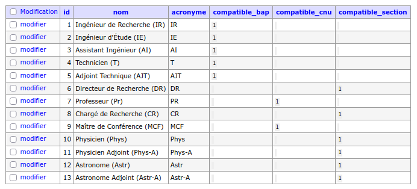

Grade :

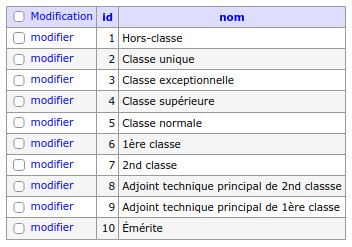

corps_grade :

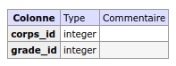

## Modifier les CNU

Pour ajouter ou modifier un CNU il suffit d'ajouter ou modifier un record dans la table `cnu`

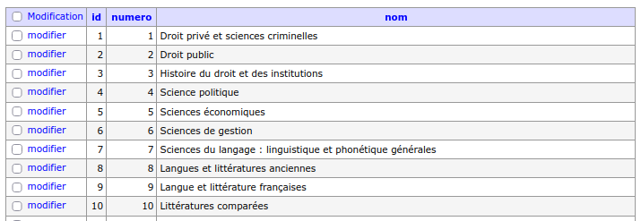

## Modifier les Sections CNRS

Pour ajouter ou modifier une section cnrs il suffit d'ajouter ou modifier un record dans la table `section_cnrs`

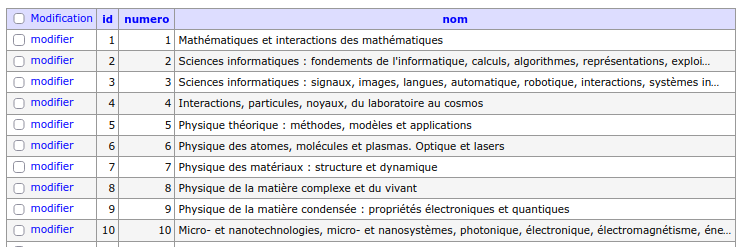

## Modifier les contrats de maintenance

Les contrats de maintenance sont également des éléments de dictionnaire modifiable depuis la base. Il s'agit de la colonne de gauche.

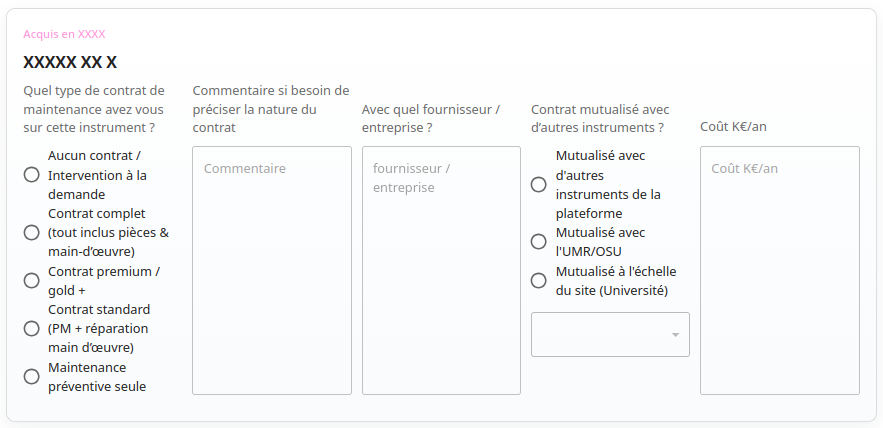

Pour ajouter ou modifier un type de contrat de maintenance il suffit d'ajouter ou modifier un record dans la table `contrat_maintenance`

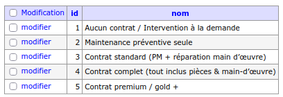

## Modifier les méthodes de determination de tarif de la plateforme

Les méthodes de determination de tarif de la plateforme sont également des éléments de dictionnaire modifiable depuis la base.

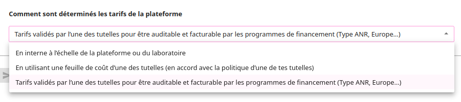

Pour ajouter ou modifier une méthodes de determination de tarif de la plateforme il suffit d'ajouter ou modifier un record dans la table `determination_tarif_methode`

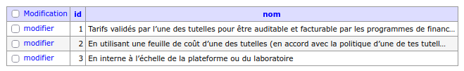

## Modifier les types d'opérations

Les types d'opérations sont également des éléments de dictionnaire modifiable depuis la base.

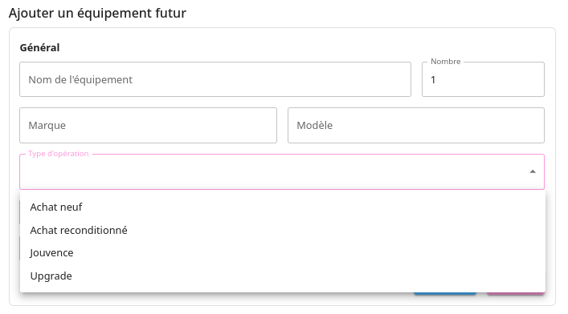

Pour ajouter ou modifier un type d'opération il suffit d'ajouter ou modifier un record dans la table `operation`

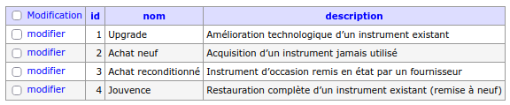

## Modifier les types de contrat

Les types de contrat sont également des éléments de dictionnaire modifiable depuis la base.

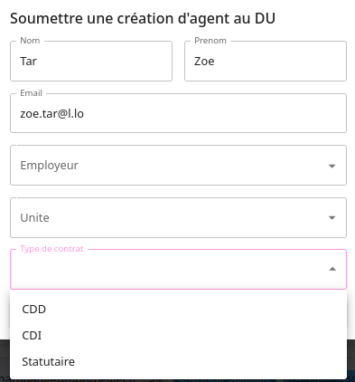

Pour ajouter ou modifier un type de contrat il suffit d'ajouter ou modifier un record dans la table `type_contrat`

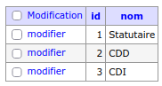

## Modifier les villes

Les villes sont également des éléments de dictionnaire modifiable depuis la base.

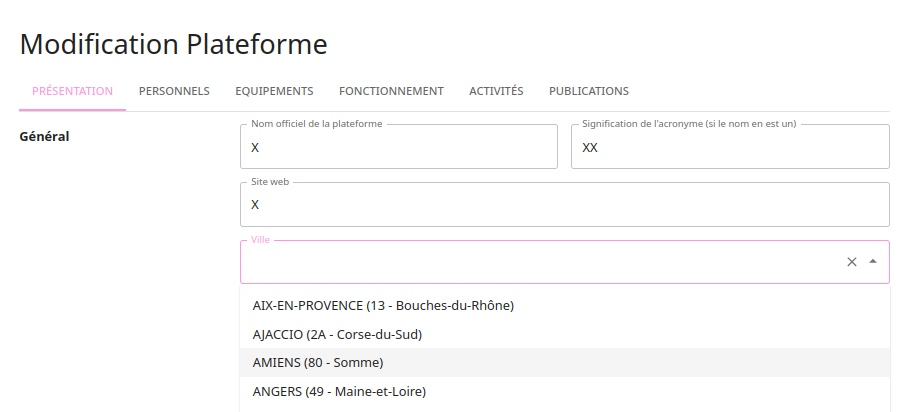

Pour ajouter ou modifier une ville il suffit d'ajouter ou modifier un record dans la table `ville`

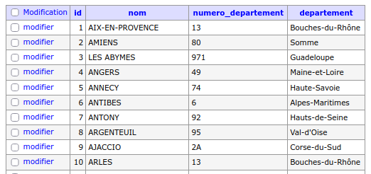